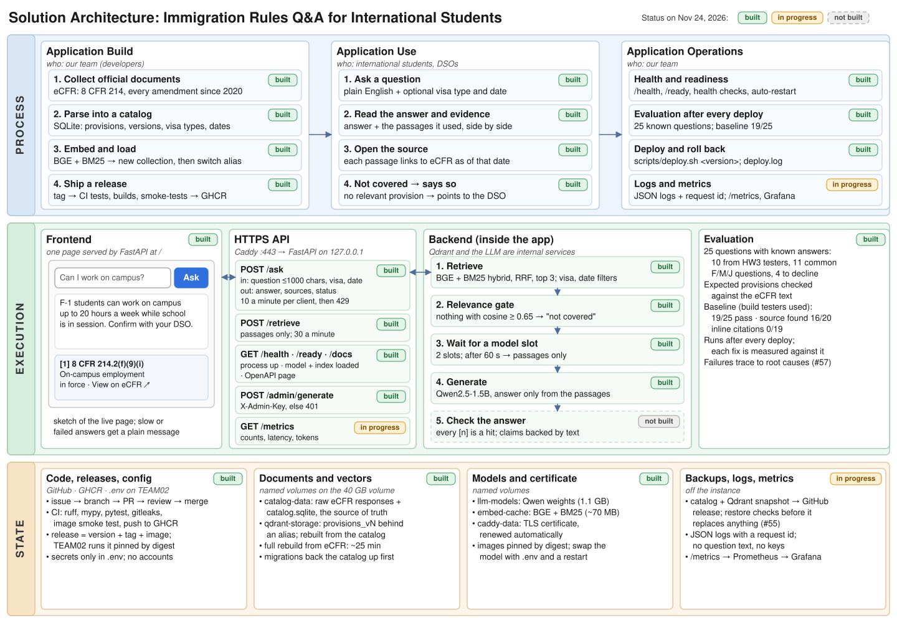
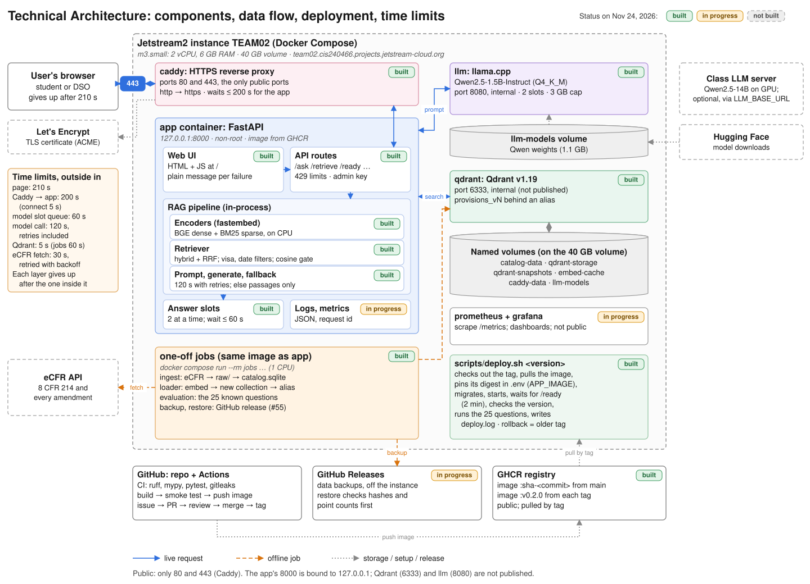

# Architecture

The system as built, revised from Deliverable 2. Each part carries its status on
Nov 24: **built**, **in progress** (open work in #60 or #55), or **not built**.
The diagrams are SVG and PNG in [architecture/](architecture/); to change one, open
`architecture/architecture.drawio` in [draw.io](https://app.diagrams.net) (two pages,
one per diagram) and export both formats again.

## Solution architecture: process, execution, state

- **Process.** We build the data and ship releases; students and DSOs ask questions
  and read the evidence; we keep it running with health checks, the evaluation set
  after every deploy, and one-command deploys and rollbacks.
- **Execution.** One page at `/`, an HTTPS API behind Caddy, and a backend that
  retrieves, gates on relevance, waits for a model slot and generates. When the model
  is down or busy, the user still gets the matching passages.
- **State.** Code and releases live in GitHub and GHCR; data, models and the
  certificate live in named Docker volumes on TEAM02's 40 GB volume; backups go to
  GitHub releases, off the instance (#55).

## Technical architecture: components, data flow, deployment

Only Caddy is reachable from the internet, on 80 and 443. The app listens on
127.0.0.1:8000, and Qdrant (6333) and llama.cpp (8080) are not published at all. CI
builds and smoke-tests every commit and publishes images to GHCR;
`scripts/deploy.sh <version>` pulls a release by tag and pins its digest on TEAM02
([runbook](runbook.md#deploy-a-release)).

## Where each time limit sits

Each layer gives up after the one inside it, so the user always gets an answer or a
clear message instead of a page that hangs.

| Layer | Gives up after | Then the user sees | Set in |
| --- | --- | --- | --- |
| Page waiting for `/ask` | 210 s | "The answer took too long" | `web/app.js` |
| Caddy waiting for the app | 200 s (connect 5 s) | 504, "The answer took too long" | `caddy/Caddyfile` |
| Waiting for one of 2 model slots | 60 s | the passages, status `model_unavailable` | `GENERATION_QUEUE_TIMEOUT_S` |
| Model call, retries included | 120 s (connect 5 s) | the passages, status `model_unavailable` | `LLM_TIMEOUT_S`, `LLM_CONNECT_TIMEOUT_S` |
| Qdrant search or readiness check | 5 s (60 s in the jobs container) | 503 with `Retry-After` | `QDRANT_TIMEOUT_S` (#66) |
| eCFR download (jobs only) | 30 s per request, retried with backoff | the job fails and can be rerun | `INGEST_REQUEST_TIMEOUT_S` |

The slowest normal answer takes about 48 s (two questions at once on two CPUs), so
60 s + 120 s leaves room for a full retry budget while staying under Caddy's 200 s.
Measurements are in [deployment.md](deployment.md#time-limits-and-retries).

## Running more than one copy (Kubernetes)

Today one app container serves everyone. Two pieces of state live inside that
process, so running two replicas behind one Kubernetes Service would break them:

| State | Where it lives | What goes wrong with two replicas |
| --- | --- | --- |
| Rate limits (`SlidingWindowLimiter` in `app.py`) | a dict in each process | each replica counts on its own, so a client gets twice the limit, and a restart forgets every count |
| Answer slots (`BoundedSemaphore` in `generation/service.py`) | a semaphore in each process | each replica lets `GENERATION_MAX_CONCURRENT` answers through, so the model server sees twice the load it has slots for, and requests queue or time out there instead of getting a quick 503 |

The fix is to move both out of the process. Rate limits go in Redis (a counter per
client and window with an expiry), or at the ingress, which most controllers can
rate-limit per client address. Answer slots become the model server's job: run
llama.cpp as its own Deployment with `--parallel` set to the slots it has, and let
the app wait on it with the existing time limits, or put a small shared queue in
front of it. Qdrant is already a separate service and the app keeps nothing else
between requests, so nothing else changes. Caddy's job moves to the ingress
controller and cert-manager.

## What changed since Deliverable 2

| Added or changed | Why |
| --- | --- |
| Caddy in front of the app, HTTPS at the instance's hostname | Encrypted traffic; the hostname survives IP changes on unshelve (#51, #59) |
| App bound to 127.0.0.1, rate limits, `/admin` behind a key | Only what users need is public (#51) |
| Ordered time limits, retries, evidence-only fallback | A broken model gives a clear answer instead of a hung page (#56) |
| Named Docker volumes | The same start on any machine; no host paths (#54) |
| GHCR images, version tags, `scripts/deploy.sh` | Ship and roll back with one command, with a deploy log (#61, #62) |
| Evaluation set run after every deploy | Notice answers getting worse even when every status is 200 (#58) |
| Answer cache dropped from the design | Questions describe a user's visa status, so answers are not cached anywhere (`Cache-Control: no-store`) |
| Backups as GitHub data releases, with a restore drill | Rebuild Qdrant without re-embedding after losing the instance (#55) |
| Cross-encoder reranker over fused results (0.4.0) | Right provision first more often; 19/25 to 22/25 on the evaluation set (#73) |
| Numbered evidence and per-sentence citations in the prompt (0.5.0) | Answers cite the source they use; 23/25 locally |
| Caddy waits for a healthy app; static files cached per release | No 502s during startup; repeat visits load faster without serving old code |
| JSON logs with request IDs, `/metrics`, Prometheus and Grafana, an `/ask` SLO | See one request end to end and whether answers are good and fast enough ([observability.md](observability.md), #60) |
